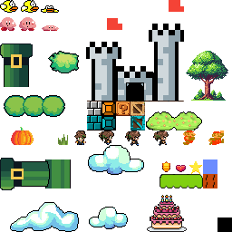

# Evershade

A small 2D platformer I made in C++ using SFML. I drew the pixel art for the characters, enemies and level myself.

## Gameplay

You have three lives and need to reach the castle at the end of the level. Jump on enemies to defeat them, collect points and hit mystery blocks to get bonuses. Some bonuses give extra lives or temporary invincibility.

The game has a scrolling level, ground and flying enemies, a score counter and a timer.

## Controls

- **Left / Right** — move
- **Up** — jump
- **Enter** — start
- **Esc** — end the run
- **R** — restart after finishing
- **Q** — return to the menu

## Run

Open this folder in CLion and run the `Evershade` target. You need CMake 3.20+ and a C++17 compiler. CMake downloads SFML 2.6.1 automatically when you build the project for the first time.
